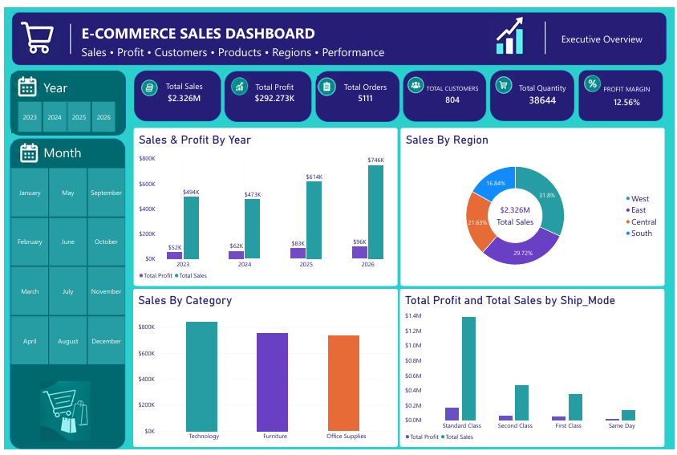
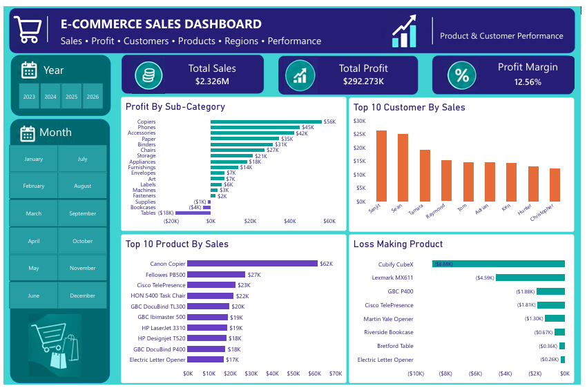
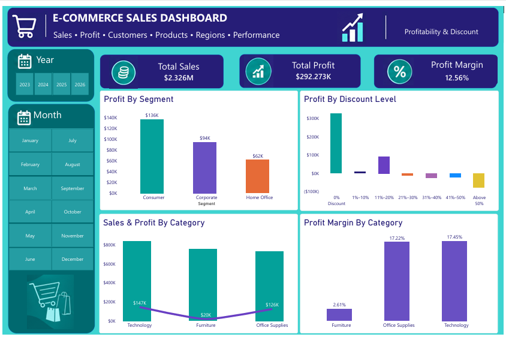
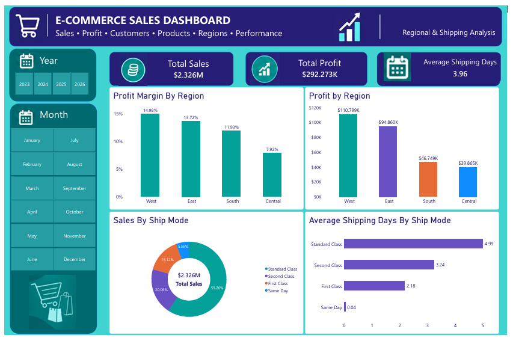

# E-Commerce Sales Analytics

**From raw data to profitable business insights using MySQL and Power BI.**

An end-to-end data analytics project that transforms a Superstore-style e-commerce dataset into actionable business insights. The project uses **MySQL** for data cleaning, validation, transformation, exploratory data analysis, and answering **25 business questions**, followed by **Power BI** for interactive reporting and dashboard development.

The final deliverables include a **four-page Power BI dashboard**, a **business report**, and an **executive PowerPoint presentation**.

**Team:** Chidi · Phebe · Toyeibat

---

## Table of Contents

1. [Business Problem](#business-problem)
2. [Project Objectives](#project-objectives)
3. [Dataset](#dataset)
4. [Tools and Skills](#tools-and-skills)
5. [Project Workflow](#project-workflow)
6. [Key Metrics](#key-metrics)
7. [Key Findings](#key-findings)
8. [Power BI Dashboard](#power-bi-dashboard)
9. [Recommendations](#recommendations)
10. [Repository Structure](#repository-structure)
11. [How to Reproduce](#how-to-reproduce)
12. [Limitations](#limitations)
13. [Contributors](#contributors)

---

## Business Problem

Sales growth does not always translate into profitable growth.

Management needs to understand:

* Where sales are generated
* Where profit is created or lost
* Which products and sub-categories are profitable
* How customer segments contribute to sales and profit
* How discount levels affect profitability
* Which regions and cities perform well or poorly
* How shipping choices affect order volume and shipping time

The objective of this project is to turn transactional sales data into evidence-based insights that can support commercial, pricing, customer, regional, operational, and financial decisions.

---

## Project Objectives

The project was designed to:

* Measure sales and profit performance over time
* Identify profitable and loss-making products and sub-categories
* Compare customer segments and customer-level sales and profitability
* Assess the relationship between discount levels and profitability
* Identify regional and geographic differences in sales and profit
* Compare shipping modes by order volume, sales, profit, and shipping time
* Develop practical recommendations for profitable growth and operational control

### Stakeholders Supported

The analysis is relevant to:

* Sales and Commercial teams
* Product teams
* Pricing and Marketing teams
* Regional Management
* Operations and Logistics
* Finance
* Senior Management

---

## Dataset

The project uses a **Superstore-style e-commerce sales dataset**.

| Item               | Detail                      |
| ------------------ | --------------------------- |
| Source file        | `data/samplesuperstore.csv` |
| Raw records        | 10,194 rows                 |
| Raw columns        | 21 columns                  |
| Cleaned records    | 10,192 rows                 |
| Duplicates removed | 2                           |
| Time period        | 2023–2026                   |
| Distinct orders    | 5,111                       |
| Distinct customers | 804                         |

For detailed field definitions and data-quality information, see the [Data Dictionary](data/DATA_DICTIONARY.md).

---

## Tools and Skills

| Tool                     | Purpose                                                                                          |
| ------------------------ | ------------------------------------------------------------------------------------------------ |
| **MySQL 8.0**            | Database creation, data import, cleaning, validation, transformation, EDA, and business analysis |
| **Power BI**             | Data modelling, calculated measures, KPI cards, visual analysis, and four-page dashboard         |
| **Microsoft Word**       | Business report                                                                                  |
| **Microsoft PowerPoint** | Executive presentation                                                                           |
| **Git & GitHub**         | Version control and project documentation                                                        |

### Skills Demonstrated

* SQL data cleaning
* SQL aggregation and grouping
* Conditional logic
* Date functions
* Ranking and analytical queries
* Data validation
* Data transformation
* Exploratory Data Analysis (EDA)
* Business-question-driven analysis
* Power BI data modelling
* KPI development
* Dashboard design
* Business storytelling
* Insight generation
* Recommendation development

---

## Project Workflow

```text
Raw CSV
   ↓
MySQL Import
   ↓
Data Cleaning
   ↓
Data Validation
   ↓
Clean Dataset
   ↓
Data Transformation
   ↓
Exploratory Data Analysis
   ↓
25 Business Questions
   ↓
Power BI Dashboard
   ↓
Business Insights
   ↓
Recommendations
```

### Analytical Process

**1. Understand the business**

Defined the business problem, stakeholders, analytical objectives, and key performance indicators.

**2. Understand the data**

Reviewed the dataset structure, fields, relationships, data types, and potential data-quality issues.

**3. Import the data into MySQL**

Loaded the raw CSV into MySQL as a staging dataset.

**4. Clean and validate the data**

Created a clean version of the dataset, removed duplicate records, validated dates and numeric fields, trimmed text fields, and checked data consistency.

**5. Transform the data**

Created analytical fields including:

* `Shipping_Days`
* `Profit_Margin`
* Year
* Quarter
* Month
* Other analytical groupings required for reporting

**6. Exploratory Data Analysis**

Performed EDA to understand sales, profit, customers, products, discounts, geography, and shipping performance.

**7. Answer 25 business questions**

Used SQL to answer business-focused questions covering:

* Sales performance
* Profitability
* Products
* Customers
* Discounts
* Regions
* Cities and states
* Shipping
* Customer segments
* Trends over time

**8. Build the Power BI dashboard**

Connected the cleaned data to Power BI and developed a four-page dashboard for executive and operational analysis.

**9. Generate insights and recommendations**

Translated analytical findings into practical business recommendations.

---

## Key Metrics

| Metric                    |         Value |
| ------------------------- | ------------: |
| **Total Sales**           | $2,326,153.86 |
| **Total Profit**          |   $292,273.46 |
| **Profit Margin**         |        12.56% |
| **Total Orders**          |         5,111 |
| **Total Customers**       |           804 |
| **Total Quantity Sold**   |        38,644 |
| **Average Order Value**   |       $455.13 |
| **Average Discount**      |        15.54% |
| **Average Shipping Days** |          3.96 |

---

## Key Findings

### 1. Sales and Profit Growth

2026 was the strongest year in the dataset, generating:

* **$745,567.53 in sales**
* **$95,926.35 in profit**

Q4 was the strongest quarter in every year represented in the dataset.

---

### 2. Regional Performance

The **West** region led overall performance:

* Sales: **$739.8K**
* Profit: **$110.8K**
* Profit margin: **14.98%**

The **Central** region generated:

* Sales: **$503.2K**
* Profit: **$39.9K**
* Profit margin: **7.92%**

This shows that sales volume alone does not necessarily translate into stronger profitability.

---

### 3. Category Performance

**Technology** led both sales and profit:

* Sales: **$839.9K**
* Profit: **$146.5K**
* Profit margin: **17.45%**

**Furniture** generated:

* Sales: **$754.4K**
* Profit: **$19.7K**
* Profit margin: **2.61%**

For comparison, Office Supplies achieved a **17.22%** profit margin.

The results indicate a significant profitability difference between product categories.

---

### 4. Sub-Category Profitability

**Tables** recorded the lowest profitability, with approximately:

* **-$17.8K profit**

Other loss-making sub-categories included:

* Supplies
* Bookcases

These areas require further investigation into pricing, discounts, product costs, and sales mix.

---

### 5. High-Sales, Loss-Making Products

Several products generated substantial sales while producing losses, including:

* Cubify CubeX 3D Printer
* Lexmark MX611dhe
* GBC DocuBind P400
* Cisco TelePresence System EX90

This highlights the importance of monitoring **profit contribution alongside sales volume**.

---

### 6. Discount and Profitability

The analysis showed an observed relationship between higher discounts and lower profitability.

* 0% discount group: **29.56% profit margin**
* Discounts above 20% were loss-making
* Discounts above 50% produced a **-118.71% margin**
* Profit at discounts above 50% was approximately **-$77.0K**

These results suggest that discount governance should consider margin impact rather than relying solely on sales uplift.

> **Note:** The analysis identifies an observed association between discount levels and profitability; it does not establish that discounts alone caused the profit differences.

---

### 7. Customer Segments

The **Consumer** segment led in both:

* Sales: **$1.17M**
* Profit: **$136.4K**

The **Home Office** segment had the highest average order value:

* **$472.38**

---

### 8. Customer Profitability

High customer spending did not always translate into high profit.

One top customer generated approximately:

* **$25.0K in sales**
* **-$1.98K in profit**

This demonstrates why customer analysis should consider **profit contribution**, not sales value alone.

---

### 9. Geographic Performance

Several states generated high sales while recording negative profit, including:

* Texas
* Ohio
* Pennsylvania
* Illinois

Loss-making high-sales cities included:

* Philadelphia
* Houston
* Chicago

These locations warrant further investigation into pricing, discounting, product mix, and cost structures.

---

### 10. Shipping Performance

**Standard Class** was the most frequently used shipping mode:

* **3,068 orders**
* Average shipping time: **4.99 days**

The analysis also indicated that shipping-time differences were more closely associated with **ship mode than region** within this dataset.

---

## Power BI Dashboard

The Power BI dashboard contains four analytical pages.

### Dashboard Pages

| Page                                  | Focus                                                                                                    |
| ------------------------------------- | -------------------------------------------------------------------------------------------------------- |
| **1. Executive Overview**             | KPI cards, sales and profit by year, sales by region, sales by category, sales and profit by ship mode   |
| **2. Product & Customer Performance** | Profit by sub-category, top customers, top products, and loss-making products                            |
| **3. Profitability & Discount**       | Profit by segment, sales and profit by category, profit margin by category, and profit by discount level |
| **4. Regional & Shipping Analysis**   | Sales and profit by region, sales by ship mode, and average shipping days by ship mode                   |

### Page 1 — Executive Overview



### Page 2 — Product & Customer Performance



### Page 3 — Profitability & Discount



### Page 4 — Regional & Shipping Analysis



---

## Recommendations

Based on the analysis, the project recommends:

1. **Tighten discount governance**, particularly for discounts above 20%, while evaluating the relationship between discounting and margin.

2. **Review high-sales, loss-making products** by examining pricing, product costs, discounts, and product-level margins.

3. **Improve Furniture profitability**, with particular attention to Tables and Bookcases.

4. **Investigate loss-making states and cities**, including Texas, Ohio, Pennsylvania, Illinois, Philadelphia, Houston, and Chicago.

5. **Manage customers based on profit contribution**, rather than sales value alone.

6. **Protect strong regional performance while investigating Central's lower margin.**

7. **Match shipping service to order economics**, balancing customer service requirements with operational costs.

8. **Monitor Q4 and other peak periods** for discount levels, product mix, and profitability.

9. **Use the Power BI dashboard as a recurring management review tool** for monitoring sales, profit, customers, products, discounts, regions, and shipping performance.

---

## Repository Structure

```text
E-Commerce-Sales-Analytics/
│
├── README.md
├── .gitignore
│
├── data/
│   ├── samplesuperstore.csv
│   └── DATA_DICTIONARY.md
│
├── sql/
│   └── ecommerce_analytics.sql
│
├── dashboard/
│   ├── ecommerce_analytics.pbix
│   └── screenshots/
│       ├── page1_executive_overview.png
│       ├── page2_product_customer.png
│       ├── page3_profitability_discount.png
│       └── page4_regional_shipping.png
│
├── reports/
│   └── Ecommerce_Business_Report_Chidi_Phoebe_Toyeibat.docx
│
└── presentation/
    └── Ecommerce_Sales_Analytics.pptx
```

---

## How to Reproduce

### Requirements

* MySQL 8.0+
* MySQL Workbench (optional)
* Power BI Desktop
* Git

### 1. Clone the repository

```bash
git clone https://github.com/Onironald/E-Commerce-Sales-Analytics.git
cd E-Commerce-Sales-Analytics
```

### 2. Prepare the CSV

The SQL script uses MySQL `LOAD DATA INFILE` to import the dataset.

Copy:

```text
data/samplesuperstore.csv
```

to your MySQL secure upload directory, for example:

```text
C:/ProgramData/MySQL/MySQL Server 8.0/Uploads/
```

Alternatively, edit the file path in:

```text
sql/ecommerce_analytics.sql
```

to match your MySQL configuration.

### 3. Run the SQL script

Open:

```text
sql/ecommerce_analytics.sql
```

in MySQL Workbench or another MySQL client and execute the script.

The script:

* Creates the `ecommerce_analytics` database
* Imports the raw dataset
* Cleans and validates the data
* Creates the analytical dataset
* Performs exploratory analysis
* Answers the 25 business questions

### 4. Open the Power BI dashboard

Open:

```text
dashboard/ecommerce_analytics.pbix
```

in Power BI Desktop.

If prompted, update the data source to your local MySQL server and connect to:

```text
Database: ecommerce_analytics
Table: ecommerce_sales
```

Then refresh the dataset.

---

## Limitations

The analysis has several limitations:

* The dataset covers a defined historical period and is not a forecast.
* `Shipping_Days` measures the period from **Order Date to Ship Date**, rather than the complete customer delivery cycle.
* The relationship between discount and profit is an observed association and does not establish causation.
* Product profitability may be affected by cost structures and other operational factors not available in the dataset.
* Geographic performance should be interpreted alongside pricing, product mix, logistics, and operating-cost information.
* Major business decisions should be supported by additional operational, pricing, financial, and customer context.

---

## Contributors

### Chidi

Data cleaning and validation in MySQL, DAX measures, Power BI dashboard, business insights, documentation

### Phebe

Data analysis, Power BI, business analysis, documentation

### Toyeibat

Data analysis, Power BI, business analysis, documentation

---

## Project Deliverables

| Deliverable           | Location                                                                                                                       |
| --------------------- | ------------------------------------------------------------------------------------------------------------------------------ |
| Raw dataset           | [`data/samplesuperstore.csv`](data/samplesuperstore.csv)                                                                       |
| Data dictionary       | [`data/DATA_DICTIONARY.md`](data/DATA_DICTIONARY.md)                                                                           |
| SQL analysis          | [`sql/ecommerce_analytics.sql`](sql/ecommerce_analytics.sql)                                                                   |
| Power BI dashboard    | [`dashboard/ecommerce_analytics.pbix`](dashboard/ecommerce_analytics.pbix)                                                     |
| Dashboard screenshots | [`dashboard/screenshots/`](dashboard/screenshots/)                                                                             |
| Business report       | [`reports/Ecommerce_Business_Report_Chidi_Phebe_Toyeibat.docx`](reports/Ecommerce_Business_Report_Chidi_Phebe_Toyeibat.docx) |
| Presentation          | [`presentation/Ecommerce_Sales_Analytics.pptx`](presentation/Ecommerce_Sales_Analytics.pptx)                                   |

---

## Project Focus

**Data Cleaning → SQL Analysis → Business Questions → Power BI → Insights → Recommendations**

This project demonstrates how raw transactional data can be transformed into structured analysis and business-focused reporting using **MySQL and Power BI**.
